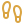

<!-- readme-standard: 2026-11-02 -->
<div align="center">



# AMM — Automated Market Maker


[](https://drasticstatic.github.io/amm)
[](https://github.com/drasticstatic/.github)
[](https://github.com/drasticstatic/amm/actions/workflows/deploy.yml)

 **You are here:** drasticstatic lab › DappU coursework › `amm` · public · `main` is the working branch

</div>

##  TL;DR

1.  **What this is.** A full-stack Automated Market Maker on Ethereum, built during DappU.
2.  **Who it is for.** Anyone learning how a constant-product pool works.
3.  **Do this first.** [View the live demo](https://drasticstatic.github.io/amm); the UI is explorable without a wallet.

A full-stack decentralized Automated Market Maker (AMM) built on Ethereum. Users can swap between two ERC-20 tokens, provide liquidity, and withdraw — all with a live price chart tracking the AMM's bonding curve over time.

**[→ View Live Demo](https://drasticstatic.github.io/amm)**

> **Note:** The live demo runs against a local Hardhat node. Smart contract interaction requires the local node running with contracts deployed. The UI is fully explorable without a wallet.

---

## Features

- **Token Swap** — exchange Token A ↔ Token B via the constant-product formula (`x · y = k`)
- **Liquidity Deposit** — provide token pairs to the pool and earn proportional LP shares
- **Liquidity Withdrawal** — redeem LP shares to reclaim your token pair
- **Price Chart** — real-time chart tracking swap history and price impact over time
- **MetaMask integration** — connect wallet to sign and submit transactions
- **Read-only demo mode** — full UI visible without wallet for portfolio showcase

---

## Tech Stack

| Layer | Tools |
|-------|-------|
| Smart contracts | Solidity, Hardhat |
| Frontend | React, Redux, React Router, React Bootstrap |
| Blockchain interaction | Ethers.js |
| Charts | ApexCharts (react-apexcharts) |
| Testing | Hardhat + Chai |

---

## Local Setup

```bash
# Install dependencies
npm install

# Start local Hardhat node
npx hardhat node

# Deploy contracts (in a separate terminal)
npx hardhat run scripts/deploy.js --network localhost

# Start React dev server
npm start
```

Open [http://localhost:3000](http://localhost:3000) — MetaMask should connect to `localhost:8545` (Chain ID 31337).

---

## Project Structure

```
contracts/        Solidity — AMM.sol, Token.sol
scripts/          deploy.js
test/             AMM.test.js
src/
  components/     React UI — Swap, Deposit, Withdraw, Charts, Navigation
  store/          Redux — actions, reducers, interactions
  abis/           Contract ABIs
  config.json     Network → contract address map
```

---

## Related

- [dao](https://github.com/drasticstatic/dao) — DAO governance with proposals + treasury
- [crowdsale](https://github.com/drasticstatic/crowdsale) — Token crowdsale with whitelist + vesting
- [nft_dappu-punks](https://github.com/drasticstatic/nft_dappu-punks) — NFT minting with reveal timer

##  Suggest a change

Noticed something? Open an [issue](../../issues) or a pull request against `main`; Christopher reads them and a person with the role merges. Not on GitHub? Reach Christopher through [his contact page](https://drasticstatic.github.io/resume/pages/contact.html).

<sub>The front door follows the living [README standard](https://github.com/drasticstatic/my-template/blob/main/README-STANDARD.md). Copy it, improve it.</sub>
